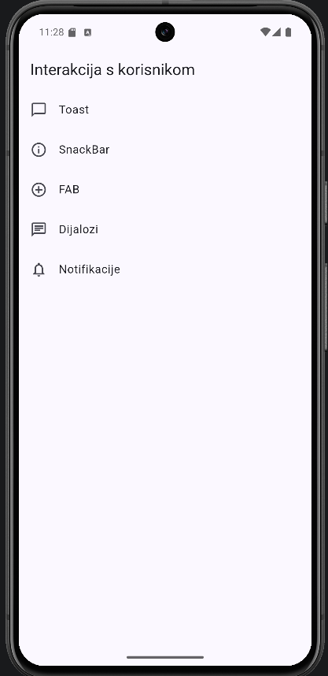

# Interakcija s korisnikom (Flutter)

Seminar iz kolegija Razvoj aplikacija za mobilne i pametne uređaje, FOI.

Aplikacija prikazuje načine na koje aplikacija šalje poruke korisniku i kako korisnik može reagirati: toast, snackbar, FAB, dijalozi i sistemske notifikacije (jednostavna i sa slikom i gumbima). Svaki koncept ima svoj ekran. Rađeno samo za Android.



## Pokretanje

Treba Flutter SDK, Android Studio (SDK + emulator, API 33+) i VS Code s Flutter ekstenzijom.

```
git clone https://github.com/vsesar24/interakcija_korisnik.git
cd interakcija_korisnik
flutter pub get
flutter run
```

## Tutorial

0. [Postavljanje okruženja](docs/00-postavljanje-okruzenja.md)
1. [Struktura projekta i početni ekran](docs/01-struktura-projekta.md)
2. [Toast](docs/02-toast.md)
3. [SnackBar](docs/03-snackbar.md)
4. [FAB](docs/04-fab.md)
5. [Dijalozi](docs/05-dijalozi.md)
6. [Jednostavna notifikacija](docs/06-notifikacije-jednostavne.md)
7. [Notifikacija sa slikom i gumbima](docs/07-notifikacije-slozene.md)

[Literatura](docs/literatura.md)

Paketi: `fluttertoast`, `flutter_local_notifications`
