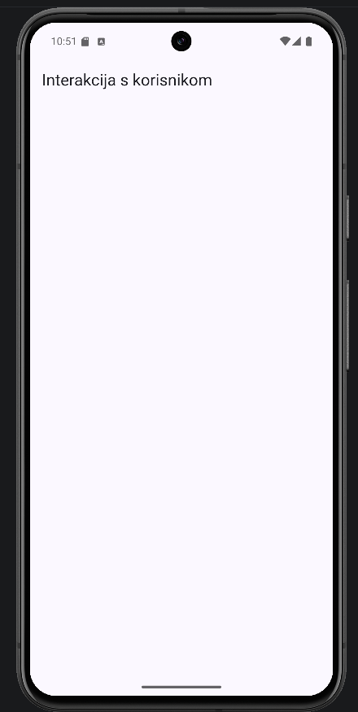

# 01 – Struktura projekta

Početni ekran je lista demoa. Svaki demo je jedan red koji otvara svoj ekran.



```
lib/
  main.dart
  models/demo.dart
  screens/home_screen.dart, detalji_screen.dart, slika_screen.dart
  demos/        ekrani za svaki koncept
  services/     notifikacije
```

`demo.dart`:

```dart
class Demo {
  final String naslov;
  final IconData ikona;
  final WidgetBuilder ekran;

  const Demo(this.naslov, this.ikona, this.ekran);
}
```

`home_screen.dart`:

```dart
final demos = <Demo>[
  Demo('Toast', Icons.chat_bubble_outline, (_) => const ToastDemo()),
  ...
];
```

```dart
body: ListView(
  children: [
    for (final demo in demos)
      ListTile(
        leading: Icon(demo.ikona),
        title: Text(demo.naslov),
        onTap: () => Navigator.push(context, MaterialPageRoute(builder: demo.ekran)),
      ),
  ],
),
```

Novi demo se doda jednim redom u `demos`. Nakon toga treba hot restart (`R`), jer hot reload ne osvježi globalnu listu.

U `main.dart` je `MaterialApp` s temom `ThemeData(colorSchemeSeed: Colors.indigo)`. Material 3 iz te jedne boje napravi cijelu paletu.

Commit: [56a0deb](https://github.com/vsesar24/interakcija_korisnik/commit/56a0deb)
