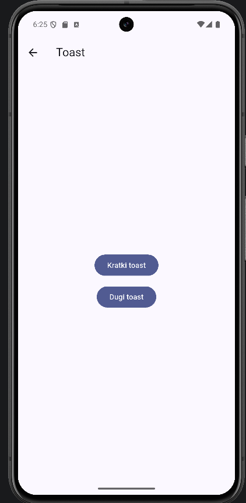
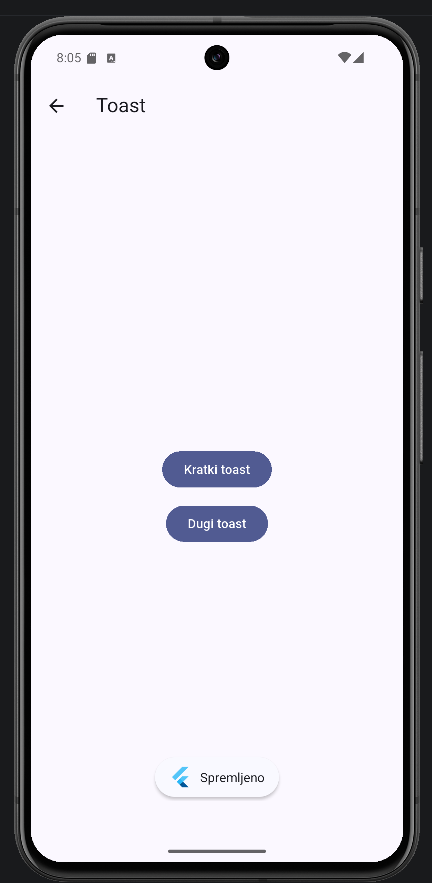

# 02 – Toast

Kratka poruka na dnu ekrana koja sama nestane. Nema akciju i ne može se kliknuti.




Koristi se za kratke potvrde ("Spremljeno"). Ne koristi se za greške i važne poruke, jer ih korisnik lako propusti. Kad je aplikacija otvorena, Android preporučuje snackbar umjesto toasta [1]. Od Androida 11 se pozicija tekstualnog toasta ne može mijenjati [11].

Flutter nema svoj toast, pa koristim paket `fluttertoast` [9]:

```
flutter pub add fluttertoast
```

```dart
void prikaziToast(String poruka, Toast trajanje) {
  Fluttertoast.cancel();
  Fluttertoast.showToast(msg: poruka, toastLength: trajanje);
}
```

```dart
FilledButton(
  onPressed: () => prikaziToast('Spremljeno', Toast.LENGTH_SHORT),
  child: const Text('Kratki toast'),
),
```

`cancel()` makne prethodni toast, da se ne slažu u red. `LENGTH_SHORT` i `LENGTH_LONG` određuju prikazuje li se toast kraće ili duže, a točno trajanje određuje Android [11].

Commit: [0c61dbd](https://github.com/vsesar24/interakcija_korisnik/commit/0c61dbd)
