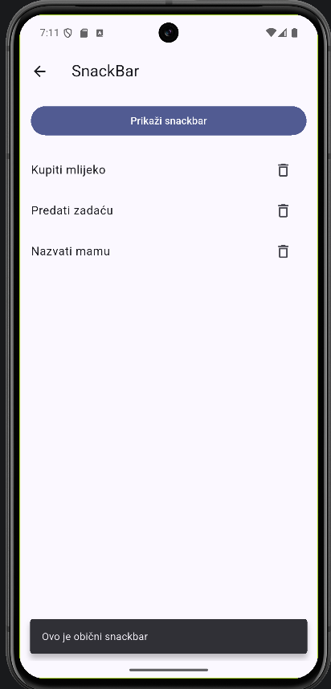
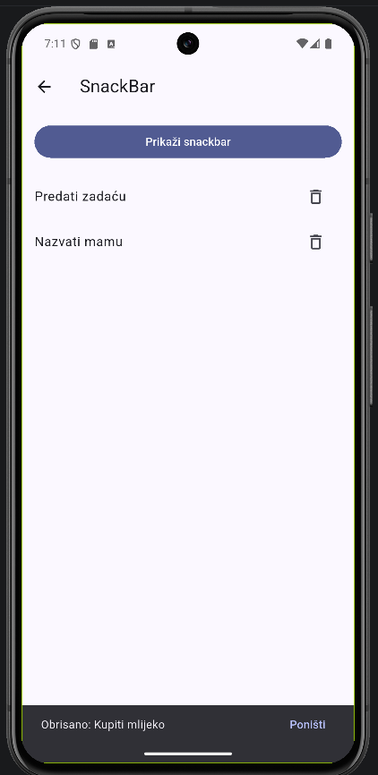

# 03 – SnackBar

Slično toastu, ali je dio aplikacije i može imati jednu akciju, npr. "Poništi".

 

Preporuke [5]: samo jedna akcija, kratak tekst i samo jedan snackbar odjednom. Ne koristiti ga za nešto što korisnik ne smije propustiti.

Ekran je `StatefulWidget` jer se lista mijenja kad se briše. `setState` javi Flutteru da ponovno iscrta ekran [18].

Snackbar se prikazuje preko `ScaffoldMessenger` [13].

Obični snackbar:

```dart
ScaffoldMessenger.of(context).showSnackBar(
  const SnackBar(
    content: Text('Ovo je obični snackbar'),
    behavior: SnackBarBehavior.floating,
  ),
);
```

Brisanje s poništavanjem:

```dart
void obrisi(int index) {
  final obrisana = stavke[index];
  setState(() => stavke.removeAt(index));

  ScaffoldMessenger.of(context)
    ..hideCurrentSnackBar()
    ..showSnackBar(
      SnackBar(
        content: Text('Obrisano: $obrisana'),
        action: SnackBarAction(
          label: 'Poništi',
          onPressed: () => setState(() => stavke.insert(index, obrisana)),
        ),
      ),
    );
}
```

Stavka i index se spreme prije brisanja, da se mogu vratiti na isto mjesto. `hideCurrentSnackBar()` makne prethodni snackbar.

Commit: [71d8e24](https://github.com/vsesar24/interakcija_korisnik/commit/71d8e24)
