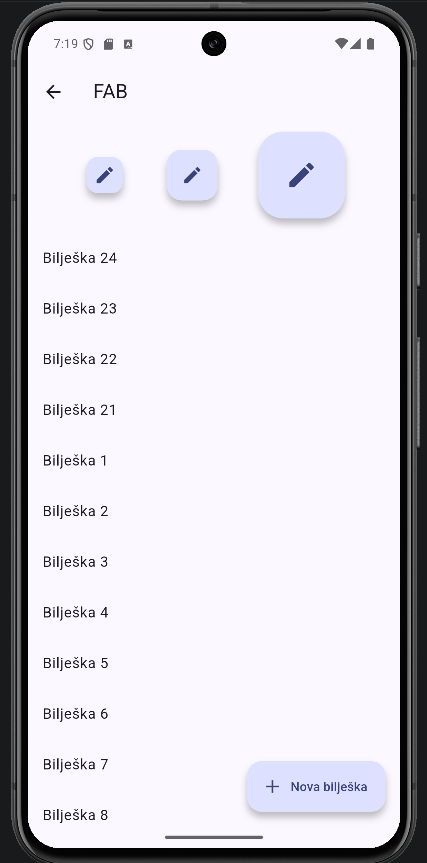

# 04 – FAB

Gumb koji lebdi dolje desno iznad sadržaja.



FAB je za glavnu akciju ekrana (dodaj, napiši) [6]. U Material 3 postoje FAB (56 dp), medium FAB (najviše preporučen) i large FAB (96 dp), a small se više ne preporučuje [6], [7]. Flutter ima `.small`, običan, `.large` i `.extended` [14].

Prema M3 FAB ostaje na mjestu kad se scrolla, a extended FAB se može smanjiti u obični [6]. Ja ga u demou skrivam pri scrollanju, da pokažem kako se reagira na scroll.

Extended FAB koji dodaje bilješku:

```dart
floatingActionButton: fabVidljiv
    ? FloatingActionButton.extended(
        onPressed: dodaj,
        icon: const Icon(Icons.add),
        label: const Text('Nova bilješka'),
      )
    : null,
```

Skrivanje kad se lista scrolla prema dolje:

```dart
NotificationListener<UserScrollNotification>(
  onNotification: (n) {
    if (n.direction == ScrollDirection.reverse) setState(() => fabVidljiv = false);
    if (n.direction == ScrollDirection.forward) setState(() => fabVidljiv = true);
    return false;
  },
  child: ListView(...),
)
```

Tri veličine su na vrhu ekrana samo kao primjer. Imaju `heroTag: null`, jer s više FAB-ova na ekranu inače dođe do greške pri navigaciji ("multiple heroes share the same tag").

Commit: [17a3d2b](https://github.com/vsesar24/interakcija_korisnik/commit/17a3d2b)
