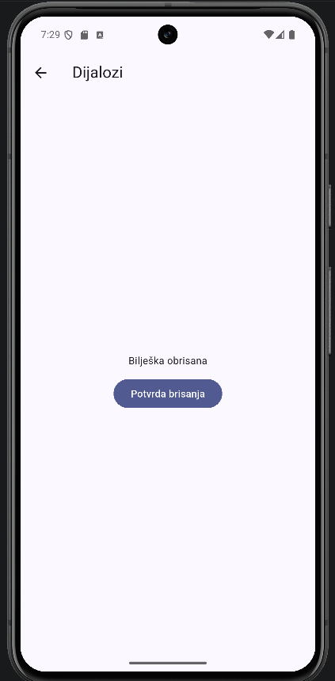
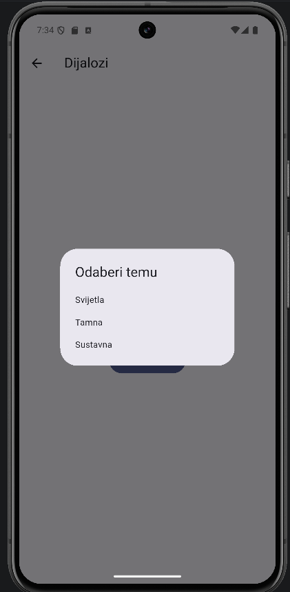
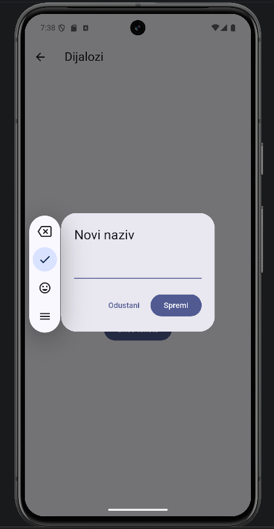

# 05 – Dijalozi

Dijalog se otvori preko ekrana i čeka da korisnik odgovori.

  

Preporuke [8]: dijaloge koristiti rijetko jer prekidaju korisnika, najviše dvije akcije (potvrda i odustajanje), a odustajanje ide lijevo od potvrde. Naslov treba biti jasno pitanje, a ne "Jeste li sigurni?". Gumb za potvrdu nazvao sam po onome što radi ("Obriši") i obojao ga crveno jer je akcija opasna.

Ako se akcija može poništiti, po meni je bolje odmah je napraviti i ponuditi "Poništi" u snackbaru, a dijalog ostaviti za ono što se ne može vratiti.

Dijalog se otvara sa `showDialog` [15] i vraća odgovor preko `Navigator.pop`:

```dart
final obrisi = await showDialog<bool>(
  context: context,
  builder: (context) => AlertDialog(
    title: const Text('Obrisati bilješku?'),
    content: const Text('Bilješka će biti trajno obrisana.'),
    actions: [
      TextButton(onPressed: () => Navigator.pop(context, false), child: const Text('Odustani')),
      TextButton(
        onPressed: () => Navigator.pop(context, true),
        style: TextButton.styleFrom(foregroundColor: Theme.of(context).colorScheme.error),
        child: const Text('Obriši'),
      ),
    ],
  ),
);
```

Ako korisnik klikne pored dijaloga, odgovor je `null`, pa se provjerava `obrisi == true`. Gumb "Obriši" je crven (`colorScheme.error`) jer je to opasna akcija.

Napravio sam tri vrste.

**1. AlertDialog** [16] – potvrda brisanja, kod je gore. Commit: [a1b4600](https://github.com/vsesar24/interakcija_korisnik/commit/a1b4600)

**2. SimpleDialog** [17] – izbor jedne opcije. Nema gumba na dnu, nego klik na opciju odmah zatvori dijalog i vrati odabrano.

```dart
final tema = await showDialog<String>(
  context: context,
  builder: (context) => SimpleDialog(
    title: const Text('Odaberi temu'),
    children: [
      for (final opcija in ['Svijetla', 'Tamna', 'Sustavna'])
        SimpleDialogOption(
          onPressed: () => Navigator.pop(context, opcija),
          child: Text(opcija),
        ),
    ],
  ),
);
if (tema != null) setState(() => rezultat = 'Odabrana tema: $tema');
```

Commit: [e74c277](https://github.com/vsesar24/interakcija_korisnik/commit/e74c277)

**3. Unos teksta** – AlertDialog s `TextField`. Tekst se sprema u varijablu dok korisnik piše (`onChanged`), a "Spremi" ga vrati. `autofocus` odmah otvori tipkovnicu.

```dart
var tekst = '';
final naziv = await showDialog<String>(
  context: context,
  builder: (context) => AlertDialog(
    title: const Text('Novi naziv'),
    content: TextField(autofocus: true, onChanged: (v) => tekst = v),
    actions: [
      TextButton(onPressed: () => Navigator.pop(context), child: const Text('Odustani')),
      FilledButton(onPressed: () => Navigator.pop(context, tekst), child: const Text('Spremi')),
    ],
  ),
);
if (naziv != null && naziv.isNotEmpty) setState(() => rezultat = 'Novi naziv: $naziv');
```

Commit: [878cdd1](https://github.com/vsesar24/interakcija_korisnik/commit/878cdd1)
