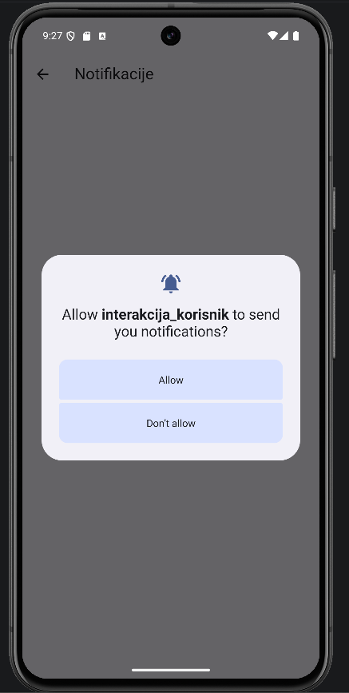
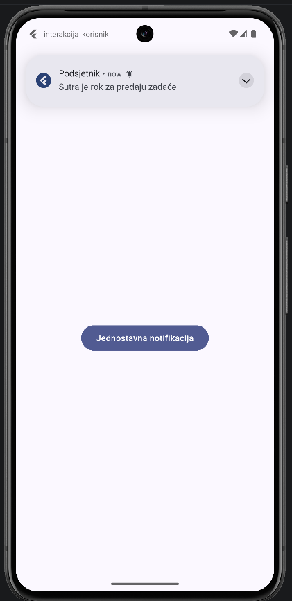
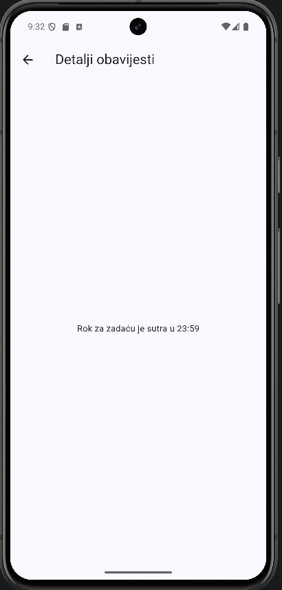

# 06 – Jednostavna notifikacija

Notifikacija se prikazuje u traci obavijesti, izvan aplikacije, pa radi i kad aplikacija nije otvorena [2]. Klik na nju otvara ekran s detaljima.

  

## Postavljanje

```
flutter pub add flutter_local_notifications
```

U `android/app/build.gradle.kts` treba uključiti desugaring [10]:

```kotlin
compileOptions {
    isCoreLibraryDesugaringEnabled = true
    ...
}

dependencies {
    coreLibraryDesugaring("com.android.tools:desugar_jdk_libs:2.1.4")
}
```

Commit: [0296877](https://github.com/vsesar24/interakcija_korisnik/commit/0296877)

## Slanje

Sav kod je u `lib/services/notifikacije.dart`.

```dart
await plugin.show(
  id: 1,
  title: 'Podsjetnik',
  body: 'Sutra je rok za predaju zadaće',
  payload: 'Rok za zadaću je sutra u 23:59',
  notificationDetails: const NotificationDetails(
    android: AndroidNotificationDetails(
      'jednostavne',
      'Jednostavne obavijesti',
      importance: Importance.high,
      priority: Priority.high,
    ),
  ),
);
```

- `'jednostavne'` je kanal. Od Androida 8 svaka notifikacija mora imati kanal [4].
- `Importance.high` znači da notifikacija iskoči na vrhu ekrana [4].
- `payload` je tekst koji se vrati kad korisnik klikne notifikaciju.
- Od Androida 13 treba tražiti dozvolu (`requestNotificationsPermission`) [3]. Tražim je tek kad korisnik klikne gumb, a ne odmah pri pokretanju.
- U `main()` se prije `runApp` poziva `inicijaliziraj()`.

Commit: [250eff4](https://github.com/vsesar24/interakcija_korisnik/commit/250eff4)

## Klik na notifikaciju

```dart
void obradiKlik(NotificationResponse odgovor) {
  navigatorKey.currentState?.push(
    MaterialPageRoute(builder: (_) => DetaljiScreen(poruka: odgovor.payload ?? '')),
  );
}
```

Ova funkcija je postavljena kao `onDidReceiveNotificationResponse` u `initialize`. Kod klika nemamo `context`, pa se navigira preko `navigatorKey` koji je dodan u `MaterialApp`.

Commit: [c6e2350](https://github.com/vsesar24/interakcija_korisnik/commit/c6e2350)

## Klik kad je aplikacija ugašena

Ako je aplikacija ugašena, `onDidReceiveNotificationResponse` se ne pozove, jer aplikacija nije radila u trenutku klika. Zato se u `main()` provjeri je li aplikacija pokrenuta iz notifikacije:

```dart
Future<void> main() async {
  WidgetsFlutterBinding.ensureInitialized();
  await inicijaliziraj();
  final pokretanje = await plugin.getNotificationAppLaunchDetails();
  runApp(const MainApp());

  final odgovor = pokretanje?.notificationResponse;
  if (pokretanje?.didNotificationLaunchApp == true && odgovor != null) {
    WidgetsBinding.instance.addPostFrameCallback((_) => obradiKlik(odgovor));
  }
}
```

`addPostFrameCallback` čeka da se nacrta prvi ekran, jer `navigatorKey` prije toga još nije spojen na `MaterialApp`.

Testiranje: poslati notifikaciju, ugasiti aplikaciju iz nedavnih aplikacija (□) i kliknuti notifikaciju. Aplikacija se pokrene i odmah otvori detalje.

Commit: [f6d1c9a](https://github.com/vsesar24/interakcija_korisnik/commit/f6d1c9a)
