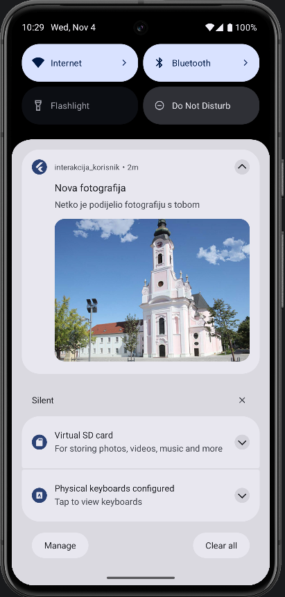
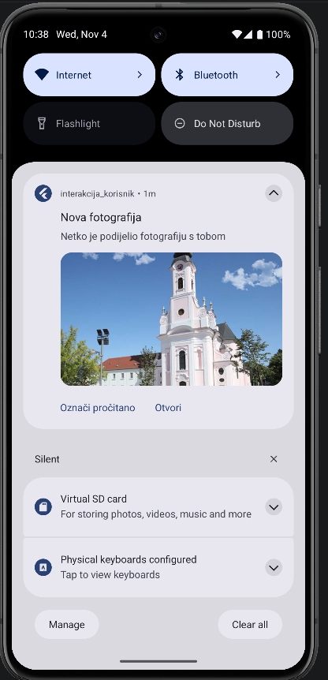

# 07 – Notifikacija sa slikom i gumbima

Notifikacija s velikom slikom i dva gumba:
- **Pogledaj sliku** – otvori sliku preko cijelog ekrana
- **Označi pročitano** – samo makne notifikaciju, bez otvaranja aplikacije

Klik na samu notifikaciju (ne na gumb) otvara detalje, kao kod jednostavne.

 

Android dopušta najviše tri gumba na notifikaciji, a gumbi ne bi smjeli raditi isto što i klik na samu notifikaciju [12]. Tekst gumba treba reći što radi, a slika treba nositi neku informaciju, a ne biti samo ukras.

## Slika

Slika je u `android/app/src/main/res/drawable/slika.png`, a ne u Flutter assets, jer notifikaciju prikazuje Android.

```dart
styleInformation: BigPictureStyleInformation(
  DrawableResourceAndroidBitmap('slika'),
),
```

Commit: [0780a32](https://github.com/vsesar24/interakcija_korisnik/commit/0780a32)

## Gumbi

```dart
actions: [
  AndroidNotificationAction('procitano', 'Označi pročitano'),
  AndroidNotificationAction('slika', 'Pogledaj sliku', showsUserInterface: true),
],
```

"Označi pročitano" nema `showsUserInterface`, pa se aplikacija ne otvara, nego se pozove funkcija u pozadini:

```dart
@pragma('vm:entry-point')
void obradiUPozadini(NotificationResponse odgovor) {
  debugPrint('Akcija u pozadini: ${odgovor.actionId}');
}
```

`@pragma('vm:entry-point')` je potreban jer ovu funkciju poziva Android, a ne moj kod. U pravoj aplikaciji bi se tu npr. spremilo da je poruka pročitana.

U `AndroidManifest.xml`, unutar `<application>` (ali ne unutar `<activity>`), treba dodati [10]:

```xml
<receiver
    android:exported="false"
    android:name="com.dexterous.flutterlocalnotifications.ActionBroadcastReceiver" />
```

Commit: [4f7eb89](https://github.com/vsesar24/interakcija_korisnik/commit/4f7eb89)

## Pogledaj sliku

Prvo je gumb bio "Otvori" i radio je isto što i klik na notifikaciju, a to je protiv Android preporuke [12]. Zato sad otvara sliku preko cijelog ekrana.


"Pogledaj sliku" ima `showsUserInterface: true`, pa se otvori aplikacija i pozove `obradiKlik`. Po `actionId` se zna je li kliknut gumb ili sama notifikacija (tada je `actionId` `null`):

```dart
void obradiKlik(NotificationResponse odgovor) {
  final ekran = odgovor.actionId == 'slika'
      ? const SlikaScreen()
      : DetaljiScreen(poruka: odgovor.payload ?? '');

  navigatorKey.currentState?.push(MaterialPageRoute(builder: (_) => ekran));
}
```

```dart
class SlikaScreen extends StatelessWidget {
  const SlikaScreen({super.key});

  @override
  Widget build(BuildContext context) {
    return Scaffold(
      backgroundColor: Colors.black,
      appBar: AppBar(backgroundColor: Colors.black, foregroundColor: Colors.white),
      body: Center(child: InteractiveViewer(child: Image.asset('assets/slika.png'))),
    );
  }
}
```

Ista slika mora biti i u Flutter `assets` (prijavljena u `pubspec.yaml`), jer ovaj ekran crta Flutter, a ne Android. `InteractiveViewer` omogućuje zumiranje.

Commit: COMMIT_SLIKA
